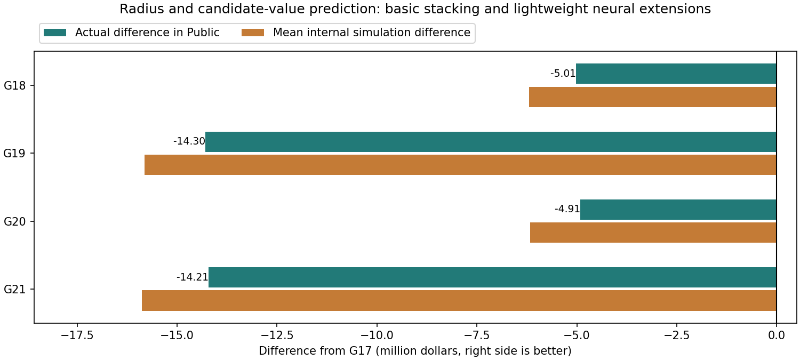

# Stacking to learn construction circle for each pipe: 2 methods and lightweight NN additional version

All four candidates scored below G17's $79,168,928.88 public result, so the existing best was retained. Adding lightweight neural networks and approximate kernels modestly improved both stacking methods, but neither surpassed the existing geometry and work order.

|Components|User method: per-pipe radius prediction|Codex method: candidate-circle values and updates|
|---|---:|---:|
|Three base models|G18:74,154,677.12|G19:64,870,357.55|
|Added neural network and approximate kernel|G20:74,260,900.63|G21:64,958,612.21|

- G20 is +$106,223.51 from G18.
- G21 is +$88,254.66 from G19.

Use 166 pipe/neighborhood features and 186 candidate features after adding 20 circle-specific fields. Base stacking combines ExtraTrees, HistGradientBoosting, and Ridge OOF predictions. Extensions add an MLP (32 → 16 hidden units, approximately 5.9k/6.5k parameters, at most 10,000 training rows) and a 64-component Nyström RBF approximation with Ridge. Neural networks and kernels were added together; public differences do not isolate neural-network effects.

Hold out the northeast region with a 500 m training buffer to assess prediction of local targets. Compare final CSVs against G17 using the same 24 settings and 128 seeds (3,072 scenarios). All four plans met coverage, budget, and deadline requirements in every scenario, but mean scores were below G17 in all 24 settings. All were submitted under the user's explicit comparison authorization.

Training targets approximate local costs of construction now versus individual-pipe construction three years later; they are not observed optimal plans. Better local approximation did not directly improve the full plan with surfaces, overlaps, annual budgets, and future leaks. Future work could learn differences in total completed-plan costs instead.

[Basic stacking implementation/internal values/official breakdown](round5/README.md) / [Lightweight model additional version](round6/README.md)

Generation code references source files and forecast snapshots in the original workspace. CSVs and fitted models are saved, but rerunning generation requires that workspace layout.
