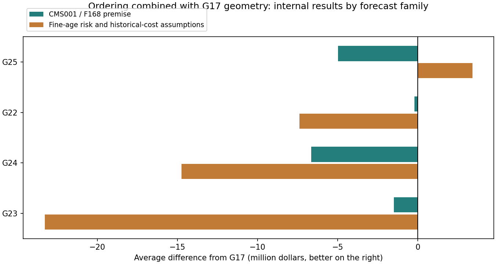

# Amy / Ryota order × G17 circle arrangement

Based on circle in G17 (Public $79,168,928.88), we submitted four proposals that combined existing rearrangements. After completing the generation, inspection, and internal evaluation, we fixed the CSV and recorded the official results.

|Candidate|Order source|Public score( dollars)|Difference from G17( dollars)|Mean internal difference( dollars)|Internal settings with positive mean gain|
|---|---|---:|---:|---:|---:|
|G22|Ryota: fixed three-year cumulative-risk order|78,027,592.07|-1,141,336.81|-3,797,439.91|4/24|
|G23|Ryota: dynamic first-three-year marginal updates, then fixed order|75,121,482.83|-4,047,446.05|-12,387,402.55|0/24|
|G24|Amy: annual BCR plus cumulative iron-length progress|72,497,399.23|-6,671,529.65|-10,697,844.85|0/24|
|G25|Ported Amy's 77.46M submission order (inherited from Ryota)|81,154,843.01|+1,985,914.13|-789,833.39|12/24|

## How to combine

For G22 to G24, only the ordering rules are ported, leak prediction is unified to F168, and conditional repair cost is unified to CMS001. This is not a re-learning reproduction of past Amy/Ryota prediction models. G25 made the order of the saved 77.46M submitted CSV correspond to the earliest order of the new circle exchange target. If multiple pipes result in the same new circle, place the circle at the position of the earliest pipe.

After reordering, calculate each row's newly replaced pipes and readjust center, radius, and splitting while covering their endpoints. All methods share a cap of 384 center positions per batch. Search same-year neighbors up to 350 m depending on local density; merge only groups reducing local expected costs. Computational limits are 16 circles/48 pipes; accepted group sizes depend on local costs.

Because geometry is also readjusted, public differences compare complete plans combining ordering and geometry; they are not causal effects of reordering alone.

Every variant preserves G17's union of replacement targets. Original coverage circles remain as a PU-only zero-cost suffix. The exported CSV was reloaded and checked for complete original-iron geometry, a $10M annual budget with carryover, and completion by 2051.

G24's original method concatenates annual plans as CSV sequences. Since the submitted CSV cannot directly specify the scheduled year, if there is a surplus of budget, the line for the next scheduled year can actually be executed earlier. Including this point, the final CSV was evaluated using the same sequential execution rules as the official one.

## Source and rating

Amy's 77.46M integrated cover proposal inherits Ryota's order. G24's alternate rules were ported from Amy's latest full-pipeline notebook's Economic Construction and Required Progress phases. The name of the person in charge is the source of the order, and the construction circle commonly uses the G17 series of Takito/Codex.

[Ryota's original code](https://github.com/reinesana/STAT440-star-kingdom-project/blob/ca6cdae4b859782e7a30d543fce686a30d52354c/submissions/2026-10-28_ryota_early3/early_three_years.py) / [Amy's original notebook](https://github.com/reinesana/STAT440-star-kingdom-project/blob/ca6cdae4b859782e7a30d543fce686a30d52354c/notebooks/Amy_Sim/star_kingdom_full_pipeline_AS.ipynb)

Internal evaluation compares against G17 using 24 settings: two forecast families, three leak-rate levels, two cost-dispersion levels, and two regional-correlation levels. Each uses 128 common-random-number scenarios, totaling 3,072, with fresh seed 202611027702. The internal key G05 is a legacy reference-arm name; the actual comparator is G17. This sensitivity analysis is conditional on existing forecasts and does not guarantee private outcomes.

## Conclusion

G25 achieved the highest public score in this round: $81,154,843.01, or $1,985,914.13 above G17. Internal results are also reported to distinguish observed public gains from superiority on unknown data.

Official breakdown: [G22](http://172.16.42.11:51238/static/output/JkawAgpRDvoPDQswCsT3J1wI.txt)

Official breakdown: [G23](http://172.16.42.11:51238/static/output/9fD4SPZN0dRKBlHYD4VJgvyw.txt)

Official breakdown: [G24](http://172.16.42.11:51238/static/output/cJp0KBVmPN6YseRIM3sP_cSB.txt)

Official breakdown: [G25](http://172.16.42.11:51238/static/output/kZOHn7zOjWemF_glE0gkDTih.txt)
